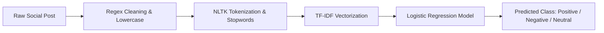

# Social Media Emotion Detection using Natural Language Processing

An end-to-end NLP and Machine Learning classification system that predicts customer sentiment (Positive, Negative, Neutral) from social media text posts.

## 📌 Problem Statement
Brands receive tens of thousands of customer comments and reviews across social platforms daily. Manually reading each post to identify customer dissatisfaction or positive sentiment is unscalable. This project implements an automated text classification pipeline to extract sentiment signals from noisy social media text.

## 🚀 Key Features
- **Comprehensive Text Preprocessing:** Regex-based cleaning (removal of URLs, punctuation, special symbols, numbers, and excess whitespace), lowercase standardization, and tokenization.
- **Linguistic Normalization:** Stopword removal and word lemmatization using NLTK.
- **TF-IDF Feature Representation:** Term Frequency-Inverse Document Frequency matrix with top 5,000 features.
- **Machine Learning Classification:** Trained Logistic Regression classifier evaluated on unseen test data.
- **Verified Dataset:** Benchmarked on the SocialBuzz Sentiment Analytics dataset (~50,000 posts).

## 🏗️ NLP Pipeline


## 📂 Repository Structure
```
Social-Media-Emotion-Detection-/
├── NLP PROJECT CODE .ipynb         # Complete preprocessing, vectorization & ML notebook
├── sentimentdataset.csv             # SocialBuzz sentiment dataset
├── Final report nlp.pdf             # Academic project report (Alliance University)
├── Screenshot 2026-10-26 092531.png # Visual results & distribution plots
└── README.md                        # Project documentation
```

## ⚙️ How to Reproduce
1. **Clone repository:**
   ```bash
   git clone https://github.com/Bhumikaravi/Social-Media-Emotion-Detection-.git
   cd Social-Media-Emotion-Detection-
   ```
2. **Install prerequisites:**
   ```bash
   pip install numpy pandas scikit-learn nltk matplotlib seaborn
   ```
3. **Open and run notebook:**
   ```bash
   jupyter notebook "NLP PROJECT CODE .ipynb"
   ```

## 👩‍💻 Author & Attribution
- **Bhumika R** (Reg No: 2411021240026)  
- Department of Computer Application, Alliance University, Bengaluru.  
- Faculty Guide: Prof. Nagasri P.
