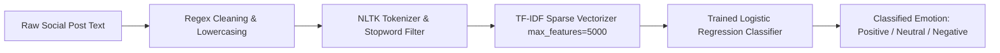

<p align="center">
  
</p>

<p align="center">
     
</p>


## 📌 Table of Contents
- [📖 Executive Summary](#-executive-summary)
- [✨ Key Features & Capabilities](#-key-features--capabilities)
- [🏗️ System Architecture & Workflow](#️-system-architecture--workflow)
- [🛠️ Tech Stack Breakdown](#️-tech-stack-breakdown)
- [⚙️ Reproducible Quickstart & Setup](#️-reproducible-quickstart--setup)
- [📂 Project Directory Layout](#-project-directory-layout)
- [👩‍💻 Author & Contributions](#-author--contributions)

---

## 📖 Executive Summary
### Problem Statement
Modern enterprises face an overwhelming volume of customer feedback across social networks. Unstructured social text contains heavy slang, typos, emojis, and noisy tokens, making manual customer sentiment tracking impossible.

### Motivation & Solution Overview
This project implements an end-to-end Natural Language Processing classification pipeline that ingests social media posts, applies structured linguistic normalization, extracts numerical features via TF-IDF, and predicts sentiment classes (Positive, Negative, Neutral).

---

## ✨ Key Features & Capabilities
- **Linguistic Preprocessing:** Regex noise elimination (URLs, handles, punctuation, digit stripping, lowercase standardization).
- **Token Filtering:** Stopword elimination and lemmatization using NLTK corpora.
- **Sparse Feature Modeling:** High-dimensional TF-IDF vectorization with top 5,000 unigram/bigram features.
- **Model Evaluation:** Logistic Regression classifier benchmarked with accuracy, precision, recall, and F1 metrics.
- **Dataset Citations:** Evaluated on the *SocialBuzz Sentiment Analytics* dataset (~50,000 posts).

---

## 🏗️ System Architecture & Workflow


---

## 🛠️ Tech Stack Breakdown
| Category | Technologies |
|---|---|
| **Programming Language** | Python 3.10+ |
| **NLP & Text Processing** | NLTK, Regular Expressions (re) |
| **Feature Extraction** | Scikit-learn (`TfidfVectorizer`) |
| **Machine Learning** | Scikit-learn (`LogisticRegression`) |
| **Data Analysis & Visualization** | Pandas, NumPy, Matplotlib, Seaborn |

---

## ⚙️ Reproducible Quickstart & Setup
### Prerequisites
- Python 3.9+
- Jupyter Notebook or VS Code

### Reproduction Steps
```bash
# 1. Clone repository
git clone https://github.com/Bhumikaravi/Social-Media-Emotion-Detection-.git
cd Social-Media-Emotion-Detection-

# 2. Install dependencies
pip install numpy pandas scikit-learn nltk matplotlib seaborn jupyter

# 3. Launch the notebook
jupyter notebook "NLP PROJECT CODE .ipynb"
```

---

## 📂 Project Directory Layout
```text
Social-Media-Emotion-Detection-/
├── Final report nlp.pdf             # Academic project report (Alliance University)
├── NLP PROJECT CODE .ipynb         # Full preprocessing, vectorization & ML notebook
├── Screenshot 2026-10-26 092531.png # Visual results & sentiment distributions
├── sentimentdataset.csv             # SocialBuzz sentiment dataset
└── README.md                        # Project documentation
```

---

## 👩‍💻 Author & Contributions
Developed by **Bhumika Ravi** ([@Bhumikaravi](https://github.com/Bhumikaravi)), Bachelor of Computer Applications (BCA) at **Alliance University, Bengaluru**.

- 💻 **GitHub Profile:** [github.com/Bhumikaravi](https://github.com/Bhumikaravi)
- 🔗 **LinkedIn:** [linkedin.com/in/bhumika-ravi-b5a01b326](https://www.linkedin.com/in/bhumika-ravi-b5a01b326/)
- 📬 **Email Contact:** [bhumikaravi2006@gmail.com](mailto:bhumikaravi2006@gmail.com)

---

<p align="center">
  
</p>
